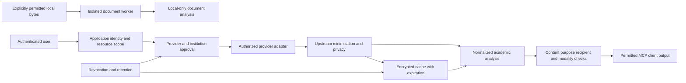

# Data Flow Diagram review template

Status: **UNVERIFIED — deployment-specific review required.**

Source implementation outline; deployment nodes and recipients remain UNVERIFIED:

Confirm exact destinations, network zones, storage keys, log sinks, browser download
routes, hosting regions and downstream retention. A conceptual arrow does not mean
the target destination has been approved.

Review owner / date / source commit and artifact hash: UNVERIFIED.
Deployment, institution, jurisdiction and intended recipients: UNVERIFIED.

List source, destination, purpose, category and policy boundary for every arrow, including browser file delivery and backups.

Maintained implementation reference: `docs/data-flow-retention.md`. This reference is a starting point, not completed acceptance.

| Assertion or inventory item | Evidence ID and exact source | Verification performed | Residual gap / owner / due date |
|---|---|---|---|
| UNVERIFIED | UNVERIFIED | Not performed | Assign during review |

Decision and bounded scope: UNVERIFIED.
Re-review trigger: change of source, recipient, provider policy, deployment, data category, dependency, retention or trust boundary.
Store confidential attachments separately under authorized administrator access; include only non-sensitive evidence IDs here.
A completed technical review does not grant external authorization.
