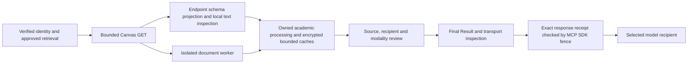

# Third-party privacy pipeline

This implementation minimizes third-party data. It does not certify anonymity,
FERPA compliance, a provider entitlement, institutional approval, or permission to
send content to an AI service. The authorization, identity, content-governance and
retention gateways remain independent requirements.

## Boundaries and components

`privacy/upstream.py` supplies positive schemas for every enabled Canvas endpoint.
Unknown nested fields and unexpected objects in scalar fields are removed before
normalization and storage. Existing route, course and credential checks still run
before and after the request. No roster, peer-submission, group-membership or
additional identity API was added. Enrollment and submission fields survive only
when their user ID exactly matches the verified server-side Connection principal.
An unknown principal does not become first-party because a request succeeded.
The profile bootstrap collects only ID and timezone, for the existing identity
verification flow.

`privacy_text.py` inspects bounded text locally, including decoded URL/HTML forms,
emails, common North American phone forms, contextual identifiers, personal
profile URLs, known encountered aliases, sensitive personal contexts and secrets.
It uses fixed replacements or `CONTENT_WITHHELD_PRIVACY_UNCERTAINTY`. It does not
send text to an external classifier. Biomedical symbols, formulas and citation
fixtures have explicit preservation tests. Names are not removed merely because
they are capitalized.

`privacy/output.py` applies the frozen academic Result field vocabulary to all
nested output dictionaries and drops unknown fields. Common scalar fields reject
new object/list shapes. This shared vocabulary preserves the existing heterogeneous
Result schema; endpoint schemas provide the more specific provider-record shapes.
The vocabulary is a checked-in inventory, never inferred from runtime data. New
tools and fields require code review and privacy tests; extending this vocabulary
alone cannot grant provider, resource or content-sharing authority.

`privacy/transport.py` reconstructs one JSON text representation from the inspected
structured Result. It rejects extra text/audio/resource blocks, unexpected private
metadata and unreviewed binary paths. The MCP handler must produce a receipt for
the exact serialized response in that request's ContextVar. A forged public
`meta.egress` or `meta.privacy` object cannot create a receipt. Changed responses
fail the SDK fence. Catalog descriptions and static resource content/metadata are
compared with their startup registration snapshots. Errors use fixed reason codes,
not exception text or reflected input. There is no MCP disable switch or resolver.

## Pseudonyms and identity

`privacy/identity.py` provides domain-separated HMAC-SHA256 pseudonyms derived
from the existing Vault key. Canonical JSON array encoding binds institution,
owner, connection, course, entity type, canonical ID, connection epoch and operator
rotation revision. There is no reversible mapping database. The scoped helper
rechecks connection identity and selected-course authorization; revocation/deletion
cannot use stale connection metadata to issue new references.

The current academic workflows omit unnecessary people rather than collecting
them to issue pseudonyms. The internal primitive is available when an approved
workflow needs a stable reference; no new people API or reidentification tool is
exposed. Pseudonyms remain personal data. Operators can change
`BRIDGE_PRIVACY_PSEUDONYM_REVISION` to invalidate reference continuity without
rotating the credential-encryption master key. This setting cannot disable the
pipeline or grant approval. Epoch changes and fresh connection IDs also separate
references. No key, original-ID/pseudonym pair, or review reference is serialized.

## Documents and binary delivery

The isolated PDF/DOCX/PPTX/XLSX/TXT/Markdown worker sanitizes text before it is
cached. Author/title/subject and other unnecessary document properties are omitted.
Office XML inspection covers accessible properties, notes, hidden parts, comments,
revision authors and relationships within limits. Encountered authors become
temporary in-memory aliases. XML inspection that exceeds bounds withholds text;
original binary objects and image pixels remain unreviewed. OCR results are
inspected again after extraction. Modified text loses fine-grained cell/run spans
whose offsets are no longer reliable; source-byte hashes remain unchanged.

Parser revision `canvas-bridge-documents-v10-privacy` invalidates older extraction
caches. Existing encrypted storage, worker isolation, lifetimes, cancellation,
deletion and backup restrictions apply. Privacy reports contain booleans and
fixed states, not identities or exact redaction counts. No new persistent raw
identity store is introduced.

The existing signed administrator `ContentReview` now has separate
`privacy_reviewed_channels` and `privacy_review_reference` fields. Missing review
fails closed for content-bearing source modalities, including metadata. Approval
of text is insufficient for pixels or originals. File reviews retain their exact
source/version/content-hash binding. Review evidence stays in the existing private
administrator evidence system and is never returned through MCP. A successful
parser, OCR result, fictional fixture, filename or model statement cannot create a
live review. The synthetic provider's fictional data path remains offline.

Original-file delivery still means unchanged original bytes, not an anonymized
file. Model-mediated originals and rendered pixels require the applicable signed
privacy and sharing reviews. User-download recipient authorization remains
separate. HTTP originals recheck the existing egress policy before headers and
each chunk; revocation stops subsequent release. Already transmitted bytes cannot
be recalled. Metadata and filename privacy checks do not sanitize an original.

## Tool inventory

All registered tools cross the final guard; unregistered tools fail closed. The
authoritative tool lists remain `policy_surfaces.py` and `egress_sources.PURPOSES`.

| Tool family | Collection and privacy treatment |
| --- | --- |
| Connection status/preferences | Fixed operational fields; no credentials or identity evidence |
| Courses/workload/changes/assignment details | Course and assignment schemas, own submission-state verification, descriptions inspected |
| Gradebook/grading policy/calculation/audit/scenarios | Verified own enrollment/submission values; no peer scores or grader identities |
| Academic audits/requirements/assessment/obligations/deadlines | Inherit source restrictions and inspected excerpts; uncertainty stays explicit |
| Outline/material/file lists and searches | No author identities; unknown metadata omitted; inspected titles/excerpts and bounded source review |
| Document reads/extraction status | Sanitized worker text and properties; separate privacy/visual coverage |
| PDF/PPTX/figure rendering and observations | Local sandbox; exact content and modality reviews; guarded ImageContent/private metadata |
| Original preparation/payload/HTTP delivery | Unchanged bytes, explicit recipient/content/privacy review, descriptor inspection and revocation checks |
| Study/calendar proposals/saved state/progress | Existing own-course authorization, inspected text, no provider writes or peer data |
| Permission diagnostics/catalog/resources/errors | Fixed reviewed vocabulary and static content; no raw exception or source payload |

## Limits and operator decisions

Pattern matching cannot reliably detect every name, non-English identifier,
handwriting, indirect reference, rare combination of facts or identifying narrative.
It also cannot establish an individual's consent or sharing rights. Accessible
PDF metadata/text inspection is not a comprehensive forensic inspection of all
PDF objects; embedded media, unknown/custom Office parts, images, active objects,
handwriting and complex layouts require appropriate review. A successful
extraction does not clear those surfaces. The synthetic test corpus is finite.

For a live pilot, authorized institutional reviewers must decide which content,
roles, purposes, recipient environments and exact modalities may be released;
verify those reviews against current files; maintain evidence and expiry; and
approve the operational handling of restricted temporary bytes. Unknown or
insufficiently reviewed content remains unavailable to the model. Review of a
faculty member's contact information is purpose-specific, not blanket permission
to release it. External-service deletion limitations remain documented in
[the lifecycle controls](data-lifecycle-controls.md).

Compatibility changes are deliberate: document properties are omitted, unknown
fields disappear, ambiguous personal text can be withheld, older content reviews
need explicit privacy fields, and modified text may lose fine-grained locators.
The existing Result schema version is unchanged, with additive `meta.privacy` and
document privacy information. Assignment fingerprints now describe selected
minimized upstream fields; original document byte hashes still identify the
original bytes. Privacy transformations never expand authorization.

Validation: [synthetic test results and measured limits](../evidence/sanitized-results/third-party-privacy-2026-10-25.md).
